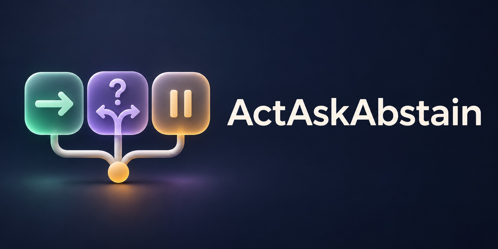

# ActAskAbstain

**Experimental decision and evaluation scripts for act, ask and abstain behavior.**

## Repository map

- [`runs/`](runs/) — experiment code and selected artifacts

## Use

Inspect the relevant script’s module docstring and argument parser before running it. Experiments may require project-specific datasets, model weights and hardware. Recreate those dependencies locally; this release does not bundle them.

## Scope and status

This is a research-code snapshot. Model weights, raw datasets, private operational notes and manuscript files are not included. Recorded results are provided as artifacts, not a claim of independent reproduction or production readiness.

Project artwork was generated with AI for repository presentation.
